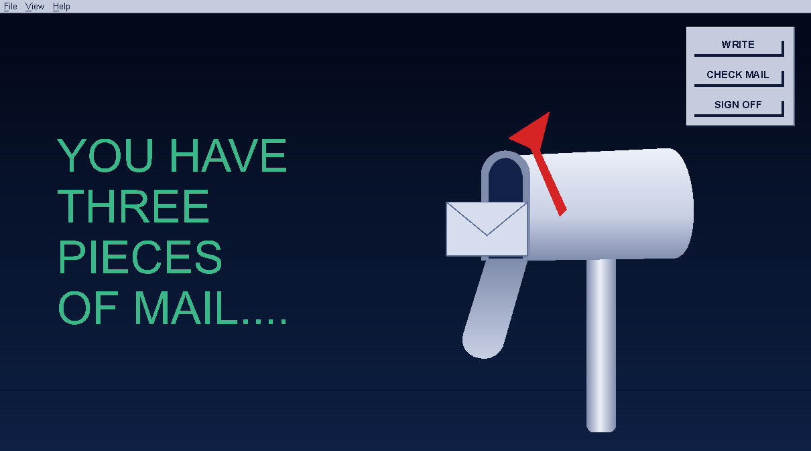
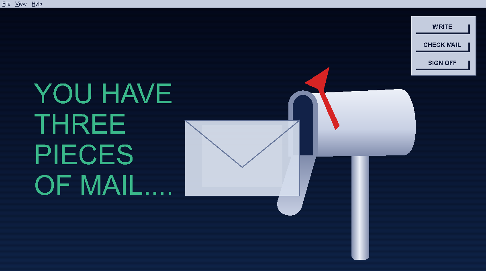
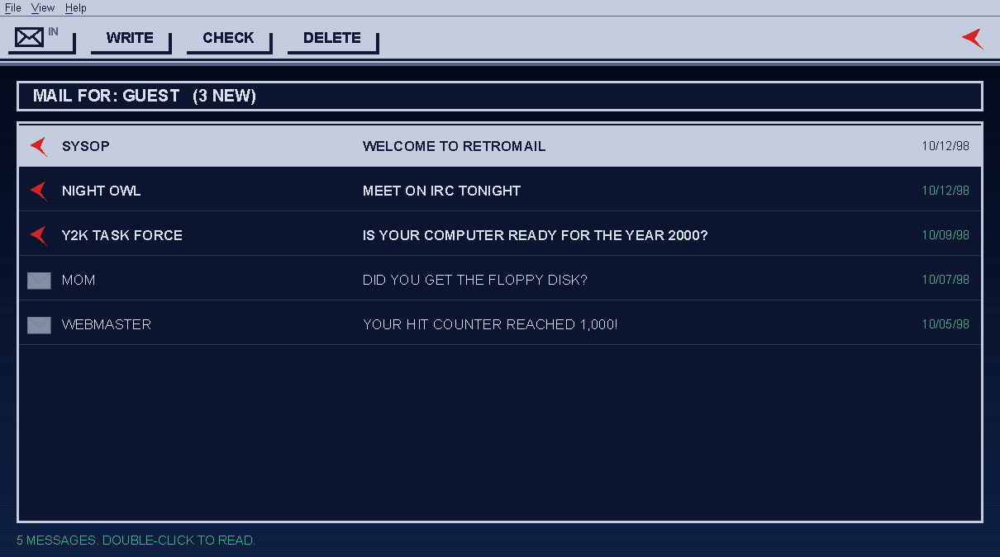
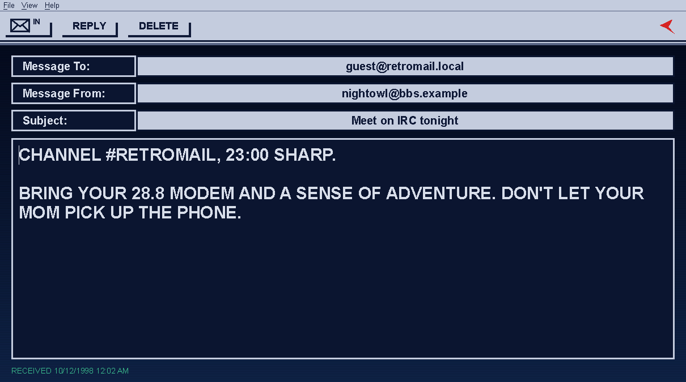
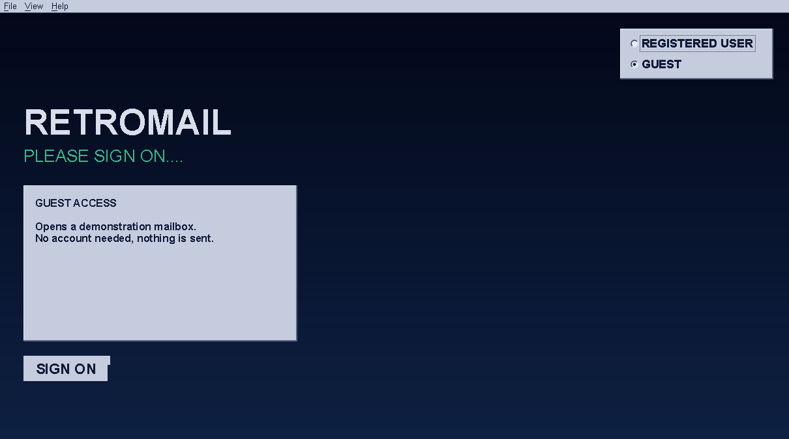
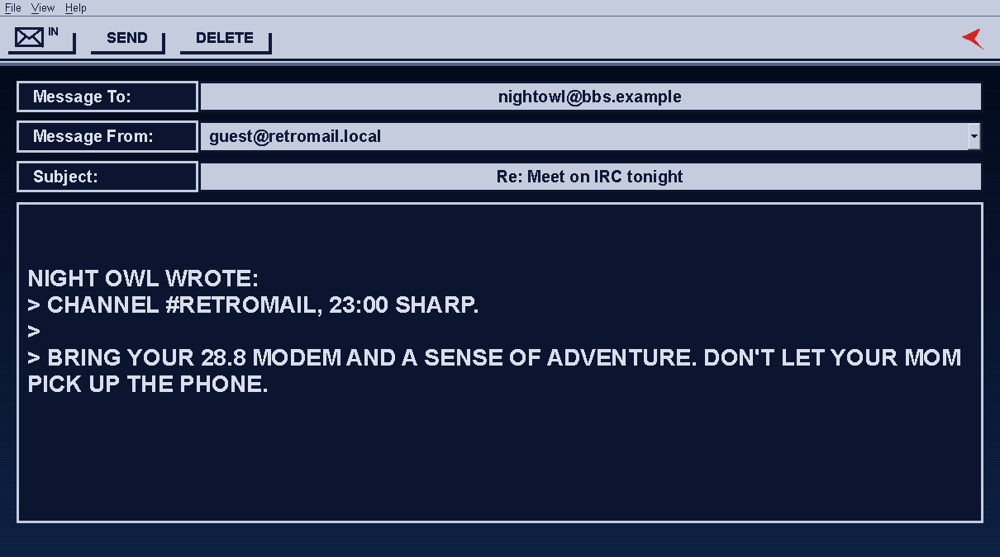

# RetroMail

**An e-mail client from 1998, built today.** RetroMail reads and sends mail from
several accounts (Gmail, Outlook/Hotmail/Microsoft 365, Yahoo, iCloud,
Fastmail or any IMAP server) with the look of a late-90s desktop mail program:
a mailbox with a red flag, a phosphor-green "YOU HAVE MAIL", chunky bevelled
buttons and big capital letters on a navy CRT.

It is written the way it would have been in 1998, in **C++ with Qt** (the same
stack as KDE's KMail, first released that year). It runs on Linux, macOS and
Windows.

| | |
|---|---|
|  |  |
|  |  |
|  |  |

## Features

- **Several accounts at once.** Each one gets its own mailbox on the screen; the flag goes up when it has new mail.
- **Gmail and Outlook sign-in through your browser (OAuth2).** RetroMail never sees those passwords.
- **App passwords** for Gmail, Yahoo, iCloud and Fastmail, and a plain password for any other IMAP/SMTP server.
- Passwords and sign-in tokens are kept in the **system keychain**: macOS Keychain, Windows Credential Manager, or GNOME Keyring/KWallet on Linux.
- Read, reply, write, delete. It checks for new mail every 3 minutes and beeps when some arrives.
- **Guest mode:** a demo mailbox you can explore without any account.
- View menu: **CRT fonts** (no font smoothing, for jagged pixel edges) and **capital letters** in messages. Both are on by default.

It is deliberately 1998-simple: plain text only, INBOX only (the newest 100
messages), and attachments are listed but can't be opened yet.

## Install

### Linux

Install the build dependencies (Qt **6.9 or newer**):

```sh
# Arch / Manjaro
sudo pacman -S --needed base-devel cmake ninja qt6-base qt6-networkauth qtkeychain-qt6

# Fedora 42+
sudo dnf install gcc-c++ cmake ninja-build qt6-qtbase-devel qt6-qtnetworkauth-devel qtkeychain-qt6-devel

# Debian / Ubuntu (needs a release that ships Qt 6.9+, check with: apt policy qt6-base-dev)
sudo apt install g++ cmake ninja-build qt6-base-dev qt6-networkauth-dev qtkeychain-qt6-dev libsecret-1-dev
```

Then build and install. This adds RetroMail to your applications menu:

```sh
./packaging/linux/install.sh                # just for you, into ~/.local
sudo ./packaging/linux/install.sh           # for everyone, into /usr/local
./packaging/linux/install.sh --uninstall    # remove it again
```

To make distributable packages (`.deb`, `.tar.gz`, plus `.rpm` if `rpmbuild` is installed) in `dist/`:

```sh
./packaging/linux/build-packages.sh
```

Build a `.deb` on the Debian/Ubuntu release you are targeting, so its
dependencies are worked out correctly.

If your distribution's Qt is older than 6.9, install a newer one with
[aqtinstall](https://github.com/miurahr/aqtinstall)
(`pip install aqtinstall && aqt install-qt linux desktop 6.9.0 linux_gcc_64 -m qtnetworkauth`)
and point CMake at it: `cmake -DCMAKE_PREFIX_PATH=$PWD/6.9.0/gcc_64 ...`.

### macOS (.dmg)

```sh
brew install cmake ninja qt
./packaging/macos/make-dmg.sh
```

This produces `dist/RetroMail-<version>-macOS.dmg`: open it and drag
RetroMail to Applications. The build is ad-hoc signed, so the first time you
open it, right-click the app and choose **Open**. For a build that opens
without that warning, set `SIGN_IDENTITY="Developer ID Application: …"` and
notarize the DMG.

### Windows (installer)

Install [Qt 6.9+](https://www.qt.io/download-qt-installer) for MSVC (include
the *Qt Network Authorization* module), Visual Studio 2022 with the C++
workload, CMake, and [NSIS](https://nsis.sourceforge.io) (`winget install NSIS.NSIS`).
Then, in a *Developer PowerShell for VS 2022*:

```powershell
.\packaging\windows\make-installer.ps1 -QtDir C:\Qt\6.9.0\msvc2022_64
```

This produces `dist\RetroMail-<version>-Windows.exe` (installer, with Start
menu and desktop shortcuts) and a portable `.zip`.

## Adding accounts

Start RetroMail, choose **REGISTERED USER**, then **ADD ACCOUNT**.

| Service | How to sign in |
|---|---|
| Gmail | Browser sign-in (needs a Google client ID, see below) **or** an [app password](https://myaccount.google.com/apppasswords) |
| Outlook / Hotmail / Microsoft 365 | Browser sign-in only (Microsoft no longer accepts passwords from mail programs); needs a Microsoft client ID |
| Yahoo | [App password](https://login.yahoo.com/account/security) |
| iCloud | [App-specific password](https://appleid.apple.com) |
| Fastmail | App password |
| Anything else | Password; fill in the IMAP (SSL, port 993) and SMTP servers |

### Two-factor authentication

- **Browser sign-in (Gmail, Outlook):** your provider's own sign-in page asks
  for the code, passkey or phone prompt as usual. RetroMail only receives a
  token afterwards, so you aren't asked again unless that access is revoked
  or expires. Then the browser opens once more.
- **App passwords (Gmail, Yahoo, iCloud, Fastmail):** these exist *because* of
  two-factor login. Mail programs can't show a code prompt, so you create a
  one-off password for RetroMail in your account's security settings (Google
  only offers them when 2-step verification is on). It skips the code, works
  only for mail, and you can revoke it at any time.
- **Other servers:** if your normal password needs a second factor, the
  server will reject it over IMAP. Use the app password your provider offers.

### Setting up browser sign-in (OAuth)

Google and Microsoft only let a mail program sign in through the browser if
it has a registered **client ID**. These are free to create. Register your
own and give them to RetroMail, either when building:

```sh
cmake -B build -DRETROMAIL_GOOGLE_CLIENT_ID=... -DRETROMAIL_GOOGLE_CLIENT_SECRET=... \
               -DRETROMAIL_MICROSOFT_CLIENT_ID=...
```

or at run time, with environment variables of the same names
(`RETROMAIL_GOOGLE_CLIENT_ID`, `RETROMAIL_GOOGLE_CLIENT_SECRET`,
`RETROMAIL_MICROSOFT_CLIENT_ID`).

**Google (Gmail)**

1. Open the [Google Cloud console](https://console.cloud.google.com/) and create a project.
2. Under *Google Auth Platform → Branding/Audience*, set up the consent screen as **External** and add your own address as a **test user**.
3. Under *Data access*, add the scope `https://mail.google.com/`.
4. Under *Clients*, create a client of type **Desktop app**. Copy the client ID and client secret. (For desktop apps the "secret" isn't really secret; Google expects it to ship inside the app.)

While the app is in "testing" mode, up to 100 listed test users can sign in.
Opening it to everyone requires Google's verification for the Gmail scope.

**Microsoft (Outlook, Hotmail, Microsoft 365)**

1. Open [Microsoft Entra → App registrations](https://entra.microsoft.com/#view/Microsoft_AAD_RegisteredApps/ApplicationsListBlade) and choose **New registration**.
2. Supported account types: **Accounts in any organizational directory and personal Microsoft accounts**.
3. Under *Authentication*, add a platform **Mobile and desktop applications** with the redirect URI `http://localhost`, and set **Allow public client flows** to *Yes*.
4. Under *API permissions*, add the delegated permissions `IMAP.AccessAsUser.All` and `SMTP.Send` (under *APIs my organization uses → Office 365 Exchange Online*), plus `offline_access` (Microsoft Graph).
5. Copy the **Application (client) ID**. There is no secret.

Work or school accounts may also need an administrator to allow the app and to
have IMAP/SMTP AUTH enabled for the mailbox.

## Using it

| Where | What |
|---|---|
| Sign-on screen | *REGISTERED USER* signs on to every ticked account; *GUEST* opens the demo mailbox |
| Mailbox screen | Click a mailbox (or press 1–9 / Enter) to open it. *WRITE*, *CHECK MAIL*, *SIGN OFF* |
| Inbox | Double-click or Enter opens a message, Delete deletes it, Esc goes back |
| Any screen | The ✉ **IN** button goes to the inbox; the red flag goes back |

`retromail --guest` opens straight into the demo mailbox.

Account settings are stored with Qt's QSettings (`~/.config/RetroMail/` on
Linux, the user preferences on macOS, the registry on Windows). Passwords and
tokens are only ever stored in the system keychain. Removing an account
deletes both; your mail stays on the server.

## Building for development

```sh
cmake -S . -B build -G Ninja -DCMAKE_BUILD_TYPE=Debug
cmake --build build
ctest --test-dir build          # MIME / message tests
./build/retromail --guest
```

QtKeychain is used from the system if available; otherwise (or with
`-DRETROMAIL_FETCH_QTKEYCHAIN=ON`, which the macOS/Windows scripts use) it is
downloaded and linked in statically.

```
src/core/     accounts, keychain, MIME parsing, mail sessions (IMAP + demo)
src/net/      IMAP client, SMTP client, OAuth2 browser sign-in
src/ui/       theme, retro widgets, mailbox artwork, the five screens
tests/        unit tests
packaging/    Linux installer and packages, macOS .dmg, Windows installer
assets/       icon (SVG source, PNG / .ico / .icns)
```

`retromail --screenshot-tour DIR` regenerates the screenshots above.

## Status

Early version (0.1). The Linux build, installer and packages are tested. The
macOS and Windows scripts follow the standard Qt deployment route
(`macdeployqt` / `windeployqt` via CMake) but haven't been run on those
systems yet. Reports and fixes are welcome.

## License

Apache License 2.0, see [LICENSE](LICENSE).
